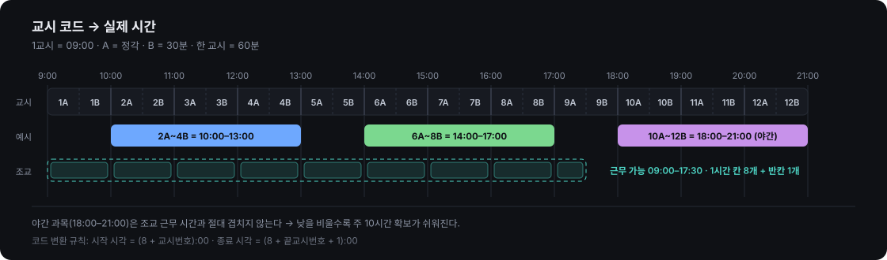
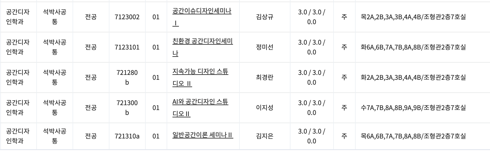
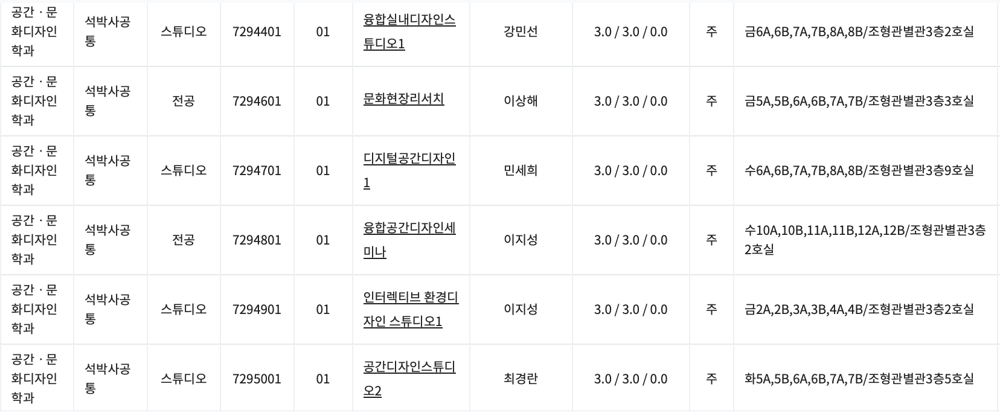
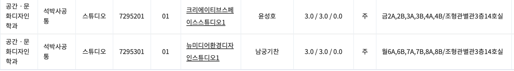
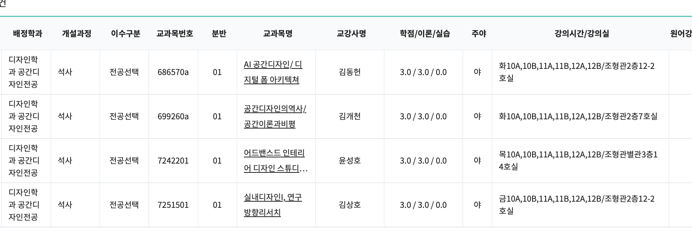

# 공간디자인 대학원 시간표 플래너

> 대학원 수강신청을 하다가 시간표가 꼬여서, 결국 시간표 프로그램을 만들어버린 이야기.

**▶ [시간표 열기 (Live)](https://banhangsim.github.io/space-design-timetable/)**



---

## 인트로 — 대학원 수강신청 과정 중 생긴 일

대학원 수강신청을 하다가 시간표가 꼬이는 일이 발생했다.

다들 타 대학원 수업을 들어본다고 하는데, 국민대는 디자인 관련 대학원도 여러 가지이고 한 번에 보기도 어렵다. **일반대학원 공간디자인학과**, **테크노디자인대학원 공간문화디자인학과**, **디자인대학원 공간디자인학과(야간)**… 이름은 비슷한데 소속 대학원이 다르고 개설 페이지도 따로 논다.

심지어 시간표는 몇 시부터 몇 시가 아니라 **1A, 1B, 2A, 2B** 이런 식으로 되어 있다. `금2A,2B,3A,3B,4A,4B` 를 보고 "아 10시부터 1시구나" 하고 바로 떠오르는 사람이 몇이나 될까.

심지어 나는 **조교 시간표도 수업에 맞추어** 짜야 한다. 주 10시간, 그것도 09:00~17:30 사이에. 박사는 본업도 해야 한다. 돈도 벌어야지…

이거 스케줄 관리 쉽게 하는 법 없나?

그래, **시간표 프로그램을 그냥 만들어 버리자.**

그렇게 해서 만들어진 시간표 프로그램의 제작기를 올린다.

---

## STEP 1 — 흩어진 시간표를 한자리에 모으기

문제의 시작은 "과목이 어디에 있는지조차 한눈에 안 보인다"는 것이었다. 대학원별로 개설 페이지를 따로 열어 캡쳐부터 떴다.

### ① 테크노디자인대학원 공간문화디자인학과 — 스튜디오 과목



`금2A,2B,3A,3B,4A,4B/조형관별관3층14호실` — 강의시간과 강의실이 한 칸에 슬래시로 붙어 있다. 사람이 읽으라고 만든 형식이 아니다.

### ② 테크노디자인대학원 공간문화디자인학과 — 전공/스튜디오 전체



6과목이 더 나왔다. 강의실은 전부 조형관 별관 3층. 이 시점에서 이미 머릿속 가시화를 포기했다.

### ③ 일반대학원 공간디자인학과 — 조형관 2층 7호실



같은 "공간디자인"인데 여기는 일반대학원 소속. 교과목번호도 `721280b`, `721310a` 처럼 알파벳이 붙어 체계가 아예 다르다. 대학원이 다르니 번호도 따로 논다.

### ④ 디자인대학원 공간디자인학과 — 야간



주야 칸이 `야`, 시간은 전부 `10A,10B,11A,11B,12A,12B`. 나중에 이 야간대가 조교 시간 확보의 열쇠가 된다.

**합계 17과목, 3개 대학원, 4개의 캡쳐.** 엑셀에 옮겨 적다가 그냥 코드로 넣기로 했다.

---

## STEP 2 — 암호 같은 교시 코드 해독하기

가장 먼저 풀어야 했던 건 `1A / 1B` 체계다. 규칙은 단순했다.

```
1교시 = 09:00 시작 · 한 교시 = 60분
A = 정각부터 30분 · B = 30분부터 정각

시작 시각 = (8 + 시작교시):00
종료 시각 = (8 + 끝교시 + 1):00
```

| 원본 표기 | 실제 시간 |
|---|---|
| `2A,2B,3A,3B,4A,4B` | 10:00 – 13:00 |
| `5A,5B,6A,6B,7A,7B` | 13:00 – 16:00 |
| `6A,6B,7A,7B,8A,8B` | 14:00 – 17:00 |
| `7A,7B,8A,8B,9A,9B` | 15:00 – 18:00 |
| `10A,10B,11A,11B,12A,12B` | 18:00 – 21:00 (야간) |

이 변환만 코드에 심으면 나머지는 그냥 좌표 계산이다. 과목 데이터는 시작/끝 **교시 번호**로만 저장하고, 화면에 그릴 때 시각으로 바꾼다.

```js
C.forEach(c => { c.h1 = 8 + c.s; c.h2 = 8 + c.e + 1; });
```

---

## STEP 3 — 주간 격자에 올리고, 충돌을 눈에 보이게

월~금 × 09:00–21:00 격자를 그리고 과목을 절대 위치로 올렸다. 같은 요일에 시간이 겹치는 과목은 **레인(lane) 알고리즘**으로 좌우로 쪼개 배치한다. 먼저 시작하는 과목부터 빈 레인을 찾아 꽂는 방식이다.

```js
const lanes = [];
list.forEach(c => {
  let i = 0;
  while (lanes[i] !== undefined && lanes[i] > c.h1) i++;
  c.lane = i; lanes[i] = c.h2;
});
```

그리고 **담은 과목끼리만** 충돌을 판정한다. 같은 요일 + 구간이 교차하면 빨간 테두리 + 우측 충돌 목록.

```js
if (a.d === b.d && a.h1 < b.h2 && b.h1 < a.h2) { /* 충돌 */ }
```

이걸 켜자마자 드러난 것들:

| 요일/시간 | 충돌 |
|---|---|
| 금 10:00–13:00 | 크리에이티브스페이스스튜디오1 ↔ 인터렉티브 환경디자인 스튜디오1 **(완전 중복)** |
| 금 13:00–17:00 | 문화현장리서치 ↔ 융합실내디자인스튜디오1 (2시간) |
| 수 14:00–18:00 | 디지털공간디자인1 ↔ AI와 공간디자인 스튜디오 II (2시간) |
| 화 13:00–17:00 | 공간디자인스튜디오2 ↔ 친환경 공간디자인세미나 (2시간) |
| 화 18:00–21:00 | AI 공간디자인 ↔ 공간디자인의역사 **(완전 중복)** |

머릿속으로는 절대 못 잡아냈을 조합이다. 특히 금요일 오전은 두 스튜디오가 완전히 같은 시간이라 애초에 둘 중 하나만 가능했다.

---

## STEP 4 — 조교 시간표를 같은 격자 위에 얹기

여기가 이 프로그램을 만든 진짜 이유다. 조교는 **주 10시간**, **09:00~17:30** 안에서 채워야 한다.

같은 격자 위에 1시간짜리 빈 칸을 깔았다. 하루에 **1시간 칸 8개(09:00–17:00) + 반칸 1개(17:00–17:30)**, 5일이면 42.5시간의 후보 슬롯. 여기서 10시간을 고르는 문제로 바뀐다.

```js
const SLOTS = [];
for (let h = 9; h < 17; h++) SLOTS.push({ h1: h, h2: h + 1, len: 1 });
SLOTS.push({ h1: 17, h2: 17.5, len: .5 });   // 17:00–17:30 반칸
```

만들면서 중요했던 규칙 두 가지:

1. **담은 수업과 겹치는 칸은 아예 잠근다.** 클릭이 안 되게 막아서 애초에 불가능한 배정을 못 하게 한다.
2. **수업을 나중에 추가하면 그 자리의 조교 배정은 자동으로 해제된다.** 수강신청은 계속 바뀌는데, 조교 시간이 유령처럼 남아 있으면 그게 제일 위험하다.

```js
const busy = chosen.some(c => c.d === d && c.h1 < s.h2 && H < c.h2);
if (busy && ta.has(key)) ta.delete(key);   // 조용히 비워준다
```

우측 패널에 `n / 10시간` 게이지와 요일별 배분량(`월 3h · 수 2h …`)을 붙였다. 10시간을 채우면 게이지가 초록, 넘기면 빨강.

### 여기서 나온 결론

**야간 과목(18:00–21:00)은 조교 근무 가능 시간(~17:30)과 절대 겹치지 않는다.**

즉 낮 수업을 줄이고 야간으로 옮길수록 주 10시간 확보가 쉬워진다. 캡쳐 네 장 중 마지막 장(디자인대학원 야간)이 결국 시간표 전체의 해법이었던 셈이다. 이걸 표 네 장 노려보면서 알아낼 수 있었을까? 나는 못 했다.

---

## 완성된 것

의존성 없는 **단일 HTML 파일**. 빌드도, npm도, 서버도 없다. 열면 그냥 돌아간다.

- **주간 격자 뷰** — 월~금 / 09:00–21:00, 겹치는 수업 자동 좌우 분할
- **과목 담기** — 클릭으로 선택, 과목 수·학점 자동 집계
- **충돌 감지** — 빨간 테두리 + 충돌 목록
- **조교 배정 모드** — 1시간 단위 칸 클릭, 주 10시간 게이지와 요일별 배분
- **자동 잠금 / 자동 해제** — 수업과 조교 시간이 물리적으로 충돌할 수 없게
- **대학원 배지** — 과목 목록에서 `테크노`·`일반`·`디자인(야)` 소속을 색으로 구분

상단 버튼으로 `과목 담기` ↔ `조교 배정` 모드를 전환한다. 과목 담기 모드에서는 이미 배정한 조교 칸만 보이고, 조교 배정 모드에서는 안 담은 과목이 흐려진다. 한 번에 한 가지만 생각하게 하려고 나눴다.

---

## 수록 과목 (17과목 · 각 3학점)

### 테크노디자인대학원 공간문화디자인학과 — 조형관 별관 3층

| 교과목명 | 교강사 | 시간 | 강의실 |
|---|---|---|---|
| 크리에이티브스페이스스튜디오1 | 윤성호 | 금 10:00–13:00 | 별관3층 14호 |
| 인터렉티브 환경디자인 스튜디오1 | 이지성 | 금 10:00–13:00 | 별관3층 2호 |
| 문화현장리서치 | 이상해 | 금 13:00–16:00 | 별관3층 3호 |
| 융합실내디자인스튜디오1 | 강민선 | 금 14:00–17:00 | 별관3층 2호 |
| 뉴미디어환경디자인스튜디오1 | 남궁기찬 | 월 14:00–17:00 | 별관3층 14호 |
| 공간디자인스튜디오2 | 최경란 | 화 13:00–16:00 | 별관3층 5호 |
| 디지털공간디자인1 | 민세희 | 수 14:00–17:00 | 별관3층 9호 |
| 융합공간디자인세미나 | 이지성 | 수 18:00–21:00 | 별관3층 2호 |

### 일반대학원 공간디자인학과 — 조형관 2층 7호

| 교과목명 | 교강사 | 시간 |
|---|---|---|
| 지속가능 디자인 스튜디오 II | 최경란 | 화 10:00–13:00 |
| 친환경 공간디자인세미나 | 정미선 | 화 14:00–17:00 |
| AI와 공간디자인 스튜디오 II | 이지성 | 수 15:00–18:00 |
| 공간이슈디자인세미나 I | 김상규 | 목 10:00–13:00 |
| 일반공간이론 세미나 II | 김지은 | 목 14:00–17:00 |

### 디자인대학원 공간디자인학과 — 야간

| 교과목명 | 교강사 | 시간 | 강의실 |
|---|---|---|---|
| AI 공간디자인 / 디지털 폼 아키텍쳐 | 김동헌 | 화 18:00–21:00 | 조형관2층 12-2호 |
| 공간디자인의역사 / 공간이론과비평 | 김개천 | 화 18:00–21:00 | 조형관2층 7호 |
| 어드밴스드 인테리어 디자인 스튜디오 | 윤성호 | 목 18:00–21:00 | 별관3층 14호 |
| 실내디자인I, 연구방향리서치 | 김상호 | 금 18:00–21:00 | 조형관2층 12-2호 |

---

## 내 과목으로 바꿔 쓰기

`index.html` 안의 `C` 배열만 고치면 된다. 다른 학과·다른 학교도 교시 체계가 같다면 그대로 쓸 수 있다.

```js
{ id:18, g:'테크노', n:'과목명', p:'교강사', d:'월', s:6, e:8, r:'강의실', k:'전공' }
```

| 키 | 의미 |
|---|---|
| `g` | 소속 대학원 배지 (`테크노`·`일반`·`디자인(야)`) |
| `d` | 요일 (`월`·`화`·`수`·`목`·`금`) |
| `s` / `e` | 시작·종료 **교시 번호** — 원본의 `6A,6B,7A,7B,8A,8B` → `s:6, e:8` |
| `r` | 강의실 |
| `k` | 이수구분 라벨 (표시용) |

조교 근무 가능 시간대를 바꾸려면 `SLOTS` 배열의 시작/끝 시각을, 목표 시간을 바꾸려면 `10`으로 하드코딩된 부분을 수정하면 된다.

---

## 직접 열어보기

```bash
git clone https://github.com/banhangsim/space-design-timetable.git
cd space-design-timetable
open index.html
```

GitHub Pages로 배포하려면: **Settings → Pages → Source: Deploy from a branch → `main` / `/ (root)`** 저장 후 1~2분.

---

## 만들고 나서

표를 읽는 일과 시간표를 짜는 일은 완전히 다른 작업이었다. 표에는 `금6A,6B,7A,7B,8A,8B` 가 적혀 있지만, 내가 알고 싶은 건 "금요일 오후가 비냐"였다. 그 변환을 사람 머리에 떠넘기니까 꼬이는 거였다.

캡쳐 네 장을 한 화면에 올리고 색을 입히니, 3개 대학원에 흩어져 있던 17과목이 그냥 **격자 위의 블록**이 됐다. 충돌도, 조교 시간이 들어갈 틈도, 야간을 써야 한다는 결론도 그 다음엔 저절로 보였다.

수강신청 기간마다 다시 캡쳐 뜨고 배열만 갈아끼우면 되니, 다음 학기에도 쓸 생각이다.

---

학사 정보는 공식 수강신청 시스템 기준이며, 이 페이지는 개인 참고용입니다. 캡쳐 이미지는 수강신청 공개 개설과목 조회 화면입니다.
